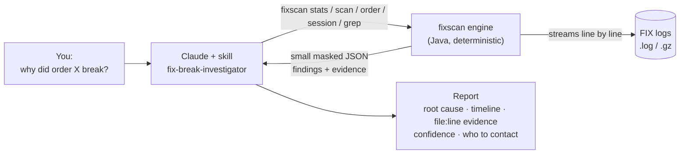

<div align="center">

# 🔎 fix-break-investigator

### Ask Claude *why a trade broke*, and get a root cause backed by log-line evidence.

A Claude Code plugin that investigates rejected orders, missing acks, stuck partial fills,
overfills, sequence gaps and booking mismatches from **FIX protocol logs**. A deterministic engine
does the reading, and Claude does the reasoning.

[](https://github.com/Santoshrt999/fix-proto-break-investigator/actions/workflows/ci.yml)
[](LICENSE)


[Install](#-install-step-by-step) ·
[Use the skill](#-using-the-skill-step-by-step) ·
[Example](#-example-investigation) ·
[Break types](#-supported-break-types) ·
[CLI](#-fixscan-cli-reference) ·
[Privacy](#-privacy-and-masking)

</div>

---

## ✨ What you get

You ask a question the way you would ask a colleague:

> **"Why was order ORD-000018 rejected? The log is samples/day1.log"**

Claude investigates and answers with a report like this:

```text
## Root cause
ORD-000018 (Buy 50,000 UMBRELLA @ 310) was rejected by BROKERX because its notional,
50,000 × 310 = 15,500,000, exceeded the account's maximum of 10,000,000.

## Confidence: high
## Timeline (UTC)    09:34:00.000  day1.log:81  BUYSIDE1 → NewOrderSingle
                     09:34:00.018  day1.log:82  BROKERX  → ExecutionReport, Rejected (103=3)
## Evidence          facts with file:line, inference clearly labelled
## Ruled out         session problem, format error
## Next steps        BROKERX risk: confirm the limit · Desk: was 15.5m intended?
```

| | |
| --- | --- |
| 🧮 **Deterministic engine** | `fixscan` (Java 21, zero runtime dependencies) streams gigabyte logs, correlates every message by order and session, and runs 12 break detectors |
| 🧠 **Investigator skill** | Claude follows a fixed loop: scope, triage, hypothesise, verify, report. It never claims a cause without a `file:line` |
| 🔒 **Private by default** | Accounts, client and party IDs are masked. Raw logs never go to the model in bulk, only small filtered JSON |
| 🛡️ **Read-only** | Diagnoses and suggests who to contact. Never sends, replays, amends or cancels anything |

---

## 🧭 How it works



**The engine filters; the model reasons.** The engine finds breaks and returns at most a few
kilobytes of JSON. The skill tells Claude how to turn that into a verified explanation.

---

## ⚡ Quickstart (60 seconds)

You need **a JDK 21+** and **Claude Code**. The engine builds itself on first use (via the
bundled Maven wrapper; needs network access to Maven Central once).

**1. Try the engine on the bundled sample, no Claude needed:**

```sh
git clone https://github.com/Santoshrt999/fix-proto-break-investigator.git
cd fix-proto-break-investigator

bin/fixscan stats samples/day1.log --format text                # what is in the log
bin/fixscan scan  samples/day1.log --format text                # every planted break, worst first
bin/fixscan order ORD-000018 samples/day1.log --format text     # one order's full story
```

**2. Install the plugin in Claude Code:**

```text
/plugin marketplace add Santoshrt999/fix-proto-break-investigator
/plugin install fix-break-investigator@fix-tools
```

**3. Ask a question from inside the cloned folder:**

```text
Why was order ORD-000018 rejected? The log is samples/day1.log
```

---

## 📦 Install step by step

This repository is **both a plugin and a marketplace**. The marketplace is what lets Claude Code
find the plugin, and the plugin is what registers the skill.

```text
fix-proto-break-investigator/
├── .claude-plugin/
│   ├── marketplace.json      ← marketplace "fix-tools": lists the plugin below
│   └── plugin.json           ← plugin "fix-break-investigator" v0.1.0
├── skills/
│   └── fix-break-investigator/
│       ├── SKILL.md          ← the investigator skill, registered automatically
│       └── references/       ← playbook, tag guide, output reference, worked example
├── bin/fixscan               ← put on Claude's PATH by the plugin
└── engine/                   ← the Java engine (built on first run)
```

<details open>
<summary><b>Option A: from GitHub, inside Claude Code (recommended)</b></summary>

1. Start Claude Code: `claude`
2. Register the marketplace. This reads `.claude-plugin/marketplace.json` from the repo:
   ```text
   /plugin marketplace add Santoshrt999/fix-proto-break-investigator
   ```
   You should see `Successfully added marketplace: fix-tools`.
3. Install the plugin from that marketplace:
   ```text
   /plugin install fix-break-investigator@fix-tools
   ```
   The format is `<plugin>@<marketplace>`.
4. Restart Claude Code so the skill is loaded.
5. Check it: run `/plugin` and look for **fix-break-investigator** under *Installed*, or type
   `/fix-break` and the skill appears in the slash-command list.

</details>

<details>
<summary><b>Option B: from GitHub, from your terminal</b></summary>

The same steps with the `claude` CLI, handy for scripts and onboarding docs:

```sh
claude plugin marketplace add Santoshrt999/fix-proto-break-investigator
claude plugin install fix-break-investigator@fix-tools

# verify
claude plugin list                                      # shows fix-break-investigator@fix-tools, enabled
claude plugin details fix-break-investigator@fix-tools  # shows Skills (1): fix-break-investigator
```

</details>

<details>
<summary><b>Option C: from a local clone (development, or no GitHub access)</b></summary>

A marketplace can be a local folder. Claude Code then reads the plugin straight from your
clone, so edits to the skill take effect after a restart.

```sh
git clone https://github.com/Santoshrt999/fix-proto-break-investigator.git
claude plugin marketplace add ./fix-proto-break-investigator
claude plugin install fix-break-investigator@fix-tools
```

Inside Claude Code the equivalent is `/plugin marketplace add ./fix-proto-break-investigator`.

</details>

<details>
<summary><b>Option D: roll out to a whole team</b></summary>

Commit this to your project's `.claude/settings.json`. Team members who trust the project folder
are offered the marketplace and the plugin automatically:

```json
{
  "extraKnownMarketplaces": {
    "fix-tools": {
      "source": { "source": "github", "repo": "Santoshrt999/fix-proto-break-investigator" }
    }
  },
  "enabledPlugins": {
    "fix-break-investigator@fix-tools": true
  }
}
```

To host it yourself, fork the repository and point `repo` at your fork (or use
`{ "source": "git", "url": "https://your-git-host/..." }`).

</details>

<details>
<summary><b>Option E: manual (skill only, no plugin system)</b></summary>

```sh
cd fix-proto-break-investigator
(cd engine && ./mvnw -DskipTests package)              # builds engine/target/fixscan.jar
mkdir -p ~/.claude/skills ~/.local/bin
cp -R skills/fix-break-investigator ~/.claude/skills/
ln -s "$PWD/bin/fixscan" ~/.local/bin/fixscan          # ~/.local/bin must be on your PATH
fixscan rules                                          # check: lists the 13 detectors
```

Keep the clone where it is: the `fixscan` link points into it.

</details>

### What the marketplace file contains

`.claude-plugin/marketplace.json` registers one plugin, served from the repository root:

```json
{
  "name": "fix-tools",
  "owner": { "name": "fix-break-investigator contributors" },
  "plugins": [
    {
      "name": "fix-break-investigator",
      "source": "./",
      "description": "Find out why a trade broke by scanning FIX logs ...",
      "version": "0.1.0"
    }
  ]
}
```

`"source": "./"` means "the plugin is this repository". Claude Code then reads
`.claude-plugin/plugin.json` and discovers every `skills/<name>/SKILL.md` on its own; skills do
not need to be listed anywhere. Check both manifests with:

```sh
claude plugin validate .
```

### Update, disable, uninstall

| Task | Command |
| --- | --- |
| Pull the latest version | `claude plugin marketplace update fix-tools` then `claude plugin update fix-break-investigator@fix-tools` |
| Turn it off for now | `claude plugin disable fix-break-investigator@fix-tools` |
| Remove the plugin | `claude plugin uninstall fix-break-investigator@fix-tools` |
| Remove the marketplace | `claude plugin marketplace remove fix-tools` |

All of these also work inside Claude Code as `/plugin ...`.

---

## 🧑‍💻 Using the skill step by step

The plugin provides **one skill: `fix-break-investigator`**. There is nothing else to run.

### Step 1. Start Claude Code where your logs are

```sh
cd /path/to/your/logs        # or the clone, to use samples/day1.log
claude
```

### Step 2. Ask your question (the skill starts by itself)

Mention FIX logs, an order, a reject, a gap or a break, and Claude loads the skill
automatically. To call it explicitly, use the slash command:

```text
/fix-break-investigator:fix-break-investigator why was ORD-000018 rejected? log: samples/day1.log
```

Give it what you know: **log paths**, the **order ID** (ClOrdID or OrderID), a **symbol**,
a **session** or a **time window**. If something is missing, Claude asks once and then gets on
with it.

### Step 3. Watch the investigation loop

The skill makes Claude follow the same five steps every time, running `fixscan` at each one:

| Step | What Claude does | Typical commands |
| --- | --- | --- |
| **1. Scope** | Checks the logs cover the time, sessions and order you asked about; stops if they do not | `fixscan stats` |
| **2. Triage** | Pulls the order's timeline or scans for breaks, groups findings by order, session and cause | `fixscan order`, `fixscan scan` |
| **3. Hypothesise** | Lists 2 or 3 likely causes from the [break playbook](skills/fix-break-investigator/references/break-playbook.md) | `fixscan explain-tag` |
| **4. Verify** | Confirms or rules out each cause with targeted queries; compares with a healthy order; works the numbers | `fixscan order`, `session`, `grep` |
| **5. Report** | Root cause, confidence, timeline, evidence (`file:line`), what was ruled out, who to contact | |

### Step 4. Read the report

Every report has the same sections, so it can be forwarded as is:

- **Root cause**: one or two sentences.
- **Confidence**: high, medium or low, with the reason.
- **Timeline (UTC)**: only the messages that matter, each with `file:line`.
- **Evidence**: *facts* from the logs kept separate from *inference*.
- **Ruled out**: hypotheses tested and why they fail.
- **Suggested next steps**: who to contact (venue or broker, client, desk, ops, middle office,
  static data, FIX connectivity, risk), what to ask them, and which IDs to send.
- **Also seen**: other breaks in the same logs, one line each.

### Step 5. Follow up

Keep asking in the same conversation, for example *"dig into the OVERFILL"*,
*"is that sequence gap related?"* or *"draft the question for the broker"*.

### Things to try on the sample log

Each of these is planted in `samples/day1.log`:

| Ask Claude | What it should find |
| --- | --- |
| Why was **ORD-000018** rejected? | Order exceeds the broker's 10m notional limit |
| Why did **ORD-000036** get no execution report? | Session-level Reject: Side(54)=Z is invalid |
| What happened to **ORD-000050**? | BusinessMessageReject: broker routing unavailable |
| The client cancelled **ORD-000069**, why was it refused? | Cancel crossed with the final fill (too late) |
| **ORD-000096** was never acked, is it live? | No ack and no inbound gap: ask the broker |
| Why is **ORD-000118** still open? | Partially filled 300/1000, no further reports |
| Why is **ORD-000131** long 600 when we ordered 500? | Overfill: two fills of 300 |
| Booking shows a different quantity for **ORD-000144** | QTY_MISMATCH: CumQty disagrees with fills |
| Ops booked **ORD-000167** twice, why? | Duplicate ExecID without PossDup |
| Why did our cancel on **ORD-000181** fail? | Broken chain: OrigClOrdID ORD-900001 unknown |
| **ORD-000195** was cancelled but then filled? | Fill reported after Canceled |
| Client says they cancelled **ORD-000211** but got filled | Cancel rejected in the closing auction, then filled 600/1500 |
| Was anything wrong with the **BROKERY** session? | 95 s silence, 3 messages missing, resend never answered |

### What is inside the skill

| File | Purpose |
| --- | --- |
| [`SKILL.md`](skills/fix-break-investigator/SKILL.md) | Ground rules, how to run fixscan, the five-step loop, the report template, edge cases |
| [`references/break-playbook.md`](skills/fix-break-investigator/references/break-playbook.md) | For each break type: symptoms, likely causes, how to confirm, who to contact. Also booking mismatches and common combinations |
| [`references/fix-tags.md`](skills/fix-break-investigator/references/fix-tags.md) | Key FIX tags and enum values, quantity rules, order state model, session recovery |
| [`references/fixscan-output.md`](skills/fix-break-investigator/references/fixscan-output.md) | Every field fixscan returns and the severity of each rule |
| [`references/example-investigation.md`](skills/fix-break-investigator/references/example-investigation.md) | A complete worked investigation |

Only `SKILL.md`'s short description is loaded in every session (about 230 tokens). The rest
loads when the skill runs.

### Rules the skill always follows

- ✅ Goes through `fixscan` for everything; never `cat`s or reads whole log files.
- ✅ Keeps masking on; asks you to confirm before ever using `--no-mask`.
- ✅ Cites `file:line` for every fact and labels inference as inference.
- ❌ Never suggests replaying, resending, amending or cancelling trades, or resetting sequence numbers.

---

## 🎬 Example investigation

A real, unedited run in Claude Code with the plugin installed (report trimmed for length):

```text
> Why was order ORD-000018 rejected? The log is samples/day1.log

● Skill(fix-break-investigator)
● Read(references/fixscan-output.md)
● Bash(fixscan stats samples/day1.log)
● Bash(fixscan order ORD-000018 samples/day1.log)
● Bash(fixscan grep 35=8,103=3 samples/day1.log --limit 20 && fixscan scan samples/day1.log --limit 10)

## Root cause
ORD-000018 (Buy 50,000 UMBRELLA @ 310) was rejected by BROKERX because its notional,
50,000 × 310 = 15,500,000, exceeded the account's maximum of 10,000,000. The reject text states
this directly, and the arithmetic matches it.

## Confidence: high
The reject reason and text state the cause, and the notional calculated from the order's own
fields matches the figure BROKERX quoted. Only one order in the log carries this reject.

## Timeline (UTC)
| Time         | Line        | From     | Message                           | Detail                                       |
| 09:34:00.000 | day1.log:81 | BUYSIDE1 | NewOrderSingle (D), MsgSeqNum 15  | ORD-000018, Buy 50000 UMBRELLA, Limit 310.00 |
| 09:34:00.018 | day1.log:82 | BROKERX  | ExecutionReport (8), MsgSeqNum 31 | Rejected, OrderID NONE, OrdRejReason(103)=3  |

## Evidence
Facts (from the logs):
- OrderQty(38)=50000, Price(44)=310.00 — day1.log:81
- OrdRejReason(103)=3 (Order exceeds limit), Text(58) "Order exceeds limit: notional
  15500000.00 > max 10000000.00 for account ***" — day1.log:82
- 50,000 × 310.00 = 15,500,000.00, matching the notional BROKERX quoted
Inference (not proven by the logs):
- Whether the 10m limit is per order, per day or cumulative needs BROKERX's risk configuration.

## Ruled out
- Session problem: no unrecovered gaps or heartbeat silences on BUYSIDE1-BROKERX; the reject
  arrived in sequence (MsgSeqNum 31).
- Field or format error: this is a business reject, not a session Reject (35=3).

## Suggested next steps
- BROKERX trading ops / risk: confirm the notional limit for the account behind ***; send
  ClOrdID ORD-000018, ExecID BXE0000027, day1.log:82.
- Buy-side trading desk: confirm whether a 15.5m order was intended.

## Also seen
- OVERFILL on ORD-000131 (CRITICAL), INVALID_STATE_TRANSITION on ORD-000195 (CRITICAL),
  unrecovered sequence gap on BROKERY→BUYSIDE1 (HIGH), and more. Not examined further.
```

---

## 🚨 Supported break types

| Rule | Severity | What it detects |
| --- | --- | --- |
| `ORDER_REJECTED` | 🟡 MEDIUM | ExecutionReport with ExecType/OrdStatus=8, with OrdRejReason(103) and Text(58) |
| `SESSION_REJECT` | 🟠 HIGH | Reject (35=3) with RefTagID(371), RefMsgType(372), SessionRejectReason(373) |
| `BUSINESS_REJECT` | 🟠 HIGH | BusinessMessageReject (35=j) |
| `CANCEL_REPLACE_REJECTED` | 🟡 MEDIUM | OrderCancelReject (35=9) |
| `NO_ACK` | 🟠 HIGH / 🟡 MEDIUM | NewOrderSingle with no ExecutionReport within the timeout (never / late) |
| `STUCK_PARTIAL` | 🟡 MEDIUM | Partially filled order with no terminal state by end of log |
| `OVERFILL` | 🔴 CRITICAL | CumQty > OrderQty |
| `QTY_MISMATCH` | 🟠 HIGH | Sum of LastQty(32) ≠ CumQty, or LeavesQty ≠ OrderQty − CumQty |
| `DUPLICATE_EXEC` | 🟠 HIGH | Repeated ExecID not flagged PossDup / PossResend |
| `BROKEN_CHAIN` | 🟡 MEDIUM | OrigClOrdID referencing an unknown ClOrdID |
| `SEQ_GAP` | 🟠 HIGH / ⚪ LOW | MsgSeqNum gap (unrecovered / recovered) or going backwards |
| `INVALID_STATE_TRANSITION` | 🔴 CRITICAL / 🟠 HIGH | Fill after Filled/Canceled, terminal order revived, CumQty decreasing |
| `PARSE_ERROR` | ⚪ LOW | Bad CheckSum(10) or BodyLength(9), truncated or malformed lines: reported, never fatal |

`samples/day1.log` has at least one planted instance of every rule, including an amend chain
whose final cancel is rejected before the order is partially filled.
`samples/expected-findings.json` lists them, and a golden test checks the scan matches exactly.

---

## 🛠 fixscan CLI reference

JSON by default, `--format text` for humans. Inputs can be plain or `.gz`; SOH, `|` and `^A`
delimiters and common log prefixes (ISO timestamps, QuickFIX/J-style lines) are recognised.

| Command | What it does |
| --- | --- |
| `fixscan stats <files...>` | Message counts by type, sessions, time range, parse errors |
| `fixscan scan <files...> [--since T] [--until T] [--session A-B] [--severity S] [--rule ID] [--limit 50]` | Summary by rule and severity, plus the most severe findings with evidence |
| `fixscan order <ClOrdID\|OrderID> <files...>` | Full lifecycle timeline of one order, including its amend/cancel chain |
| `fixscan session <Sender-Target> <files...>` | Sequence gaps, resends, resets, logons, heartbeat health |
| `fixscan grep <tag=value>[,tag=value] <files...> [--limit N]` | Matching messages, decoded and masked. `*` wildcards (quote them), tag names allowed |
| `fixscan explain-tag <tag> [value]` | Dictionary meaning of a tag or enum value |
| `fixscan rules` | List the break detectors |
| `fixscan generate` | Regenerate the synthetic sample log (fixed seed) |

| Option | Meaning |
| --- | --- |
| `--ack-timeout SECS` | NO_ACK threshold (default 30) |
| `--dict FILE` | Add or override tag definitions for venue or firm custom tags (same JSON shape as the built-in dictionary) |
| `--mask-tags 50,57` | Mask more tags |
| `--no-mask` | Turn masking off (prints a warning) |
| `FIXSCAN_JAVA_OPTS` | JVM options, for example `-Xmx6g` for multi-gigabyte logs |

Every finding carries an id, rule, severity, session, ClOrdID chain, timestamps, a one-line
summary and up to five evidence lines (`file:line` plus the masked message).

---

## 🔒 Privacy and masking

- **Masking is on by default.** Account(1), ClientID(109) and PartyID(448) become `***`. In
  Text(58), account-like tokens, email addresses and names or IDs after cue words (account,
  client, trader, user...) are masked, and the reject reason stays readable. Add tags with
  `--mask-tags`.
- **`--no-mask`** turns masking off and prints a warning. The skill only uses it if you ask and
  confirm you may see that data.
- **Read-only.** fixscan never writes to logs and never opens a network connection.
- **Small output only.** The skill never reads whole log files; only fixscan's filtered, capped
  JSON reaches the model.
- **Synthetic data.** This repository uses only public FIX specifications and generated data.
  BUYSIDE1, BROKERX and BROKERY are fictitious.

---

## 🩺 Troubleshooting

| Symptom | Fix |
| --- | --- |
| `Java 21 or newer is required` | Install a JDK 21+ (for example Temurin) or set `JAVA_HOME` |
| First run is slow or fails with `build failed` | The first run builds the jar and downloads Maven once. Build by hand: `cd engine && ./mvnw -DskipTests package` |
| Claude says `fixscan: command not found` | Check the plugin is enabled (`claude plugin list`) and restart Claude Code. For a manual install, put `bin/fixscan` on your PATH |
| The skill does not start | Mention FIX logs or an order ID, or call it with `/fix-break-investigator:fix-break-investigator` |
| `no matches found` from the shell | Quote wildcard queries: `fixscan grep '11=ORD-0002*' file.log` |
| `messages: 0` in `stats` | The log format is not recognised: fixscan expects `8=FIX...` messages, optionally after a prefix |
| Custom tags show as unknown | Pass the venue's dictionary with `--dict` |

---

## ⚙️ Performance

The engine streams line by line and keeps compact per-order and per-session state. The
performance smoke test scans **~550k messages (136 MB) in about 2 seconds** on a laptop; a 1 GB
log takes seconds to tens of seconds depending on the machine.

---

## 🗺 Roadmap

| Phase | Scope |
| --- | --- |
| ✅ **1** | FIX log engine, 12 break detectors, investigator skill (this release) |
| **2** | Protobuf / JSON booking events through a pluggable `EventSource` |
| **3** | FIX-versus-booking reconciliation |
| **4** | Splunk / ELK connectors |

---

## 🤝 Contributing

New break detectors, dictionary entries and playbook improvements are welcome. See
[CONTRIBUTING.md](CONTRIBUTING.md). In short: `cd engine && ./mvnw verify`, use synthetic data
only, and keep everything read-only.

## 📄 License

Apache-2.0. See [LICENSE](LICENSE) and [NOTICE](NOTICE).
